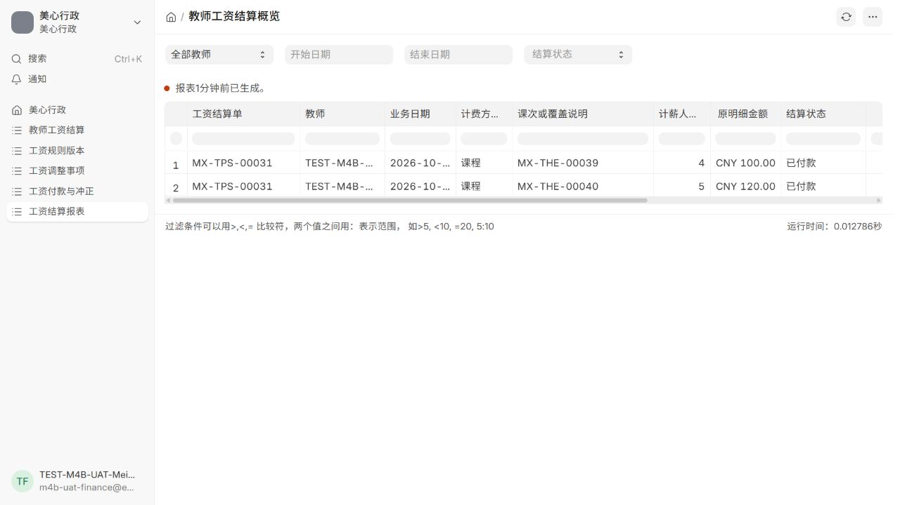
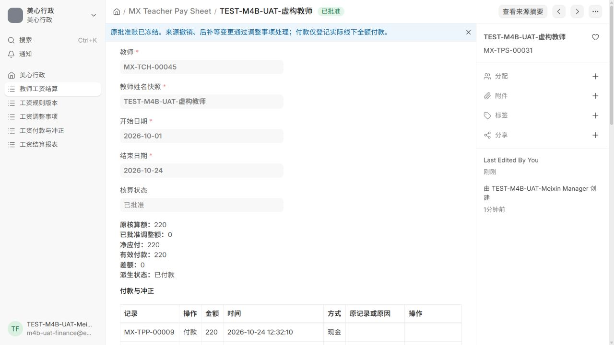

# M4-B 隔离开发与验收交付

日期：2026-10-24（Asia/Shanghai）。状态：实现及隔离验证完成，提交用户验收；不代表用户人工验收、合并或正式发布。

## 交付与基线

- 仓库：PENGYUQI12138/meixin-ai-admin-system。
- 基线：`6fae2b9c978b3c812a0d999d01bec2dade9c3f80`，封存标签 `m4-a-accepted-2026-10-01`；开始时远端 main 未变化。
- 独立分支：`m4-b-teacher-payroll`。设计 checkpoint `f021a7b`；实现及测试提交 `78fc478`，其后只归档验收材料及更新状态。
- 独立检出：本次任务 `work/meixin_admin`，原封存检出保持原提交且干净。
- 正式六应用镜像实查仍为 `meixin-admin:m4a-6fae2b9-firstlaunch-frappe16.34.0`、revision `6fae2b9…`；正式接续核验为只读，本轮未执行正式业务写入、迁移、恢复或配置变更。
- 恢复工作时 Docker Desktop 未运行。启动引擎后，正式容器随原重启策略恢复；此为已有运行策略，不是本轮重建/部署。隔离操作随后只指向下列两个新项目。

## 选型结论

沿用本会话 2026-10-23 已完成的 GitHub 实际核查和用户批准的 B 路线：在现有 meixin_admin 中增量实现，无新运行时依赖。

| 路线 | 已核查依据与结果 |
| --- | --- |
| A：直接使用现成工资功能 | 已安装 ERPNext 的 Timesheet 为小时费率，Payment Entry 进入会计科目/总账链路；均不直接满足美心按整节、班级人数及覆盖防重。HRMS 当前 version-16 依赖 Frappe/ERPNext ≥16.50，现站16.34/16.35不满足；旧版声明范围匹配不代表实测兼容。 |
| B：基于现有项目增量实现（采用） | 复用教师、排课、M4-A 不可变分钟事实、事务锁、精确人民币校验、Desk、权限及原生报表导出。只补规则、核对快照、覆盖、批准、付款和调整。 |
| C：另建工资系统 | 将重复档案、权限、审计和部署，当前规模没有必要。 |

官方来源：[Frappe / MIT](https://github.com/frappe/frappe)、[ERPNext / GPL-3.0](https://github.com/frappe/erpnext)、[HRMS / GPL-3.0](https://github.com/frappe/hrms)、[HRMS version-16 依赖](https://github.com/frappe/hrms/blob/version-16/pyproject.toml)。维护证据及兼容范围核查已在前一阶段完成；本轮没有为继续已批准实施重新选型，没有安装 HRMS 或升级框架。

## 已实现行为

1. 生效规则配置人数档位和单价，普通课原始起止恰为90分钟才可正常计价；不使用分钟除90，不以实际到课人数定价。
2. 冻结名单预填，行政补全班级人数及历史依据；缺依据、异常时长或争议不能自动通过正常计薪。特殊金额与固定费必须明确金额及原因，空金额保持待核对；显式0与未填写分开。
3. 单教师任意日期范围结算，待核对→行政核对→财务批准。批准前重建并比较来源、人数依据、规则和覆盖快照，变化要求重新核对。原批准账冻结。
4. 固定费用支持全天授课或指定课程/工作事项。指定课程可跨所选日期范围，每个覆盖仍使用真实授课日；费用有明确归属日。工作事项按教师及稳定标识跨日期防重。
5. 普通、特殊、指定和全天覆盖共用原始课次及修订链身份；核对才占用，草稿不永久占课；撤回未批准单释放占用，批准后保留来源身份。事务锁和唯一键防并发重复。
6. 全天后补同日授课产生重新核对事项，且不能再另单按节计费。固定费部分课程撤销不自动扣整笔费用，交财务决定。
7. 仅财务批准、付款和冲正，行政页面或直接调用服务 API 均被拒绝。财务通过摘要查看履职信息，原学生、排课、执行和课时文档仍不对纯财务角色开放。
8. 每单按当时净应付整单一次登记实际线下付款；金额由服务器计算。普通重复请求返回原结果或拒绝冲突；错误登记经唯一冲正后可重新登记，原记录不改。无自动转账。
9. 批准前撤销阻止批准；批准后未付款撤销暂停付款，财务批准调整后按净额处理；已付款撤销保留原账和付款，生成唯一待处理事项。零净应付无虚假付款，负净应付或多付差额仍待财务处理，不自动扣下期、不标为退款。
10. 原生工资明细报表及CSV/XLSX导出遵守工资读取权限。金额使用CNY，不改全站默认币种。查询不取得写锁；超过来源/报表上限明确要求缩小范围，不静默漏项。

设计：[M4_B_DESIGN.md](M4_B_DESIGN.md)。迁移和回退：[M4_B_MIGRATION.md](M4_B_MIGRATION.md)。

## 实际测试结果

| 验证 | 实际结果 | 证据 |
| --- | --- | --- |
| 原回归及当时新增工资测试整套 | **201/201**；原152 + 当时49；0失败/错误/跳过；75.685秒 | [完整原始日志](validation/m4-b-2026-10-24/m4b-full-regression.log.gz) |
| 最终工资模块专项复核 | **54/54**；0失败/错误/跳过；48.893秒，三应用同版本隔离站 | [最终工资日志](validation/m4-b-2026-10-24/m4b-latest-payroll-regression.log.gz) |
| 精确人民币无框架单测 | **2/2** | [金额单测](validation/m4-b-2026-10-24/m4b-money-unit-tests.log.gz) |
| 静态检查 | 84 Python、29 产品/配置JSON、16 JS语法通过；高置信凭据模式0；Git空白检查最终通过 | [静态日志](validation/m4-b-2026-10-24/m4b-static-checks-final.log.gz) |
| MariaDB唯一索引 | 五表八个必要唯一字段实查通过 | [唯一索引日志](validation/m4-b-2026-10-24/m4b-unique-index-verification.log.gz) |
| 本轮私有凭据定值扫描 | 源码及输出检查6个本轮私有凭据，0命中；凭据和备份不入库 | [扫描摘要](validation/m4-b-2026-10-24/private-secret-scan.json) |

两组集成测试有重叠，不能相加为255个独立用例；最终没有把未实际执行的“206项整套”记为通过。M1—M4-A 四个原测试文件未改，原断言保留。

工资测试覆盖：4人到3人100、5人到4人120、合计220；取消不计薪；规则/名单变化不改旧批准账；全日、指定、工作、跨日及跨单防重；全日后补；非90分钟及90分59秒；人数依据/金额缺失；三阶段撤销；固定费部分撤销；零/负应付；付款冲正及重登；真实财务角色；行政管理角色/排课员直接财务API拒绝；来源隐私；报表及CSV/Excel权限；真实多进程核对、批准、付款、撤销、冲正竞争；故障注入与全事务回滚。Frappe平台Administrator仍为超级用户，不作为日常行政或财务账号。

## 浏览器与界面

独立站 `http://localhost:18085`，纯虚构行政和财务用户，全部TEST-M4B-UAT数据。

- 行政实际创建并核对 `MX-TPS-00031`：两节100+120=220。
- 纯财务实际批准，登记付款 `MX-TPP-00009`，冲正 `00010`，重新登记 `00011`；有效付款220，差额0。已付款页面不再显示重复登记按钮。
- 财务来源摘要无学生姓名、名单、电话和原异常原因原文；直接打开原排课页面被权限拒绝。
- 报表实际显示CNY100/CNY120及单据首行净应付/有效付款220，实际CSV有对应两行；Excel生成及CNY样式另外通过专项数据库测试。
- 最终重新打开报表，控制台warn/error为0。[最终浏览器检查](validation/m4-b-2026-10-24/final-browser-check.json)

完整浏览器过程、首期静态资源失败、重启时Socket.IO历史错误及截图保留在本机任务 `outputs/m4b-browser`；未把历史错误删除后宣称全过程零错误。最终新页面核验与历史日志分开记录。

## 带历史数据的升级演练

使用新项目 `meixin_m4b_upgrade_check`、独立DB/sites/网络，仅db/redis/app三个容器，无frontend或端口映射；未连接正式卷或数据库。

先只读挂载6fae2b9基线，建立虚构历史：5名学生、1教师、两张4/5人名单排课及执行、2笔教师确认、1课包、2000元收款、授予20后扣2剩18的权益账。迁移前执行带公私文件备份，材料仅留私有隔离卷/工作目录。

为覆盖正式同型三应用，在此新隔离站安装镜像内已有ERPNext16.35（没有下载/升级依赖），保留准备前快照和备份。官方安装器给该隔离Administrator增加内置角色的差异如实记录；两个虚构业务用户角色及既有业务未变。三应用准备后重新采基线和备份，再仅将这个新项目app挂载切到M4-B并migrate、clear-cache。

升级前后三应用基线比较结果：

- **14张旧业务表及MX Settings完整记录计数和摘要一致**。
- **2000元实收、18课包余额及各笔明细一致**。
- **旧DocPerm语义、Administrator和两个虚构业务用户的实际角色一致**；未给用户分配财务角色。
- 新7类工资表、必要唯一键和查询索引存在；新业务记录全部0，没有回填工资；新CNY元数据校验通过。
- 最终54项工资测试结束后恢复原设置，旧业务、余额、权限及角色快照再次一致。

证据：[升级汇总](validation/m4-b-2026-10-24/upgrade-summary.json)、[隔离资源](validation/m4-b-2026-10-24/upgrade-resources.json)、[ERPNext准备阶段差异](validation/m4-b-2026-10-24/upgrade-preparation.json)、[测试后历史保留复核](validation/m4-b-2026-10-24/latest-regression-preservation.json)。原始迁移日志及备份摘要留在本机 `outputs/m4b-upgrade`。

## 已修问题和未执行范围

首轮核对快照受框架对子行字典补字段影响，批准误判变化；已改用独立副本。旧hooks缓存曾造成DocShare测试失败，仅隔离clear-cache后复核通过。独立子表写入口、工作事项跨日期重复、报表先截断后筛选、无mutex的查询写锁已修并补回归。浏览器暴露的静态资源、新建按钮及美元符号问题已修。最后空字符串金额草稿问题修复后54项全部重跑通过。首轮/第二轮/最终前失败日志均归档或保留，没有弱化原断言。

未执行：合并、推送、正式备份/迁移/部署、正式业务写入或恢复；未安装HRMS、升级依赖、接银行或总账。没有正式历史副本升级、正式镜像/public资产构建或长时间稳定性验证；本轮虚构历史演练不代替这些未来发布检查。

继续M4-A单教师边界，现实中的代课/共教仍需人工识别，不能通过此工资流程宣称已支持。工作事项需使用稳定标识，不得为同一事项另造标识。负差额和已付调整留待财务实际处理，系统不自动扣款或确认退款。

归档文件及无损压缩校验：[证据索引](validation/m4-b-2026-10-24/index.json)。本机密码文件和原始备份不在交付补丁或公开仓库中。
