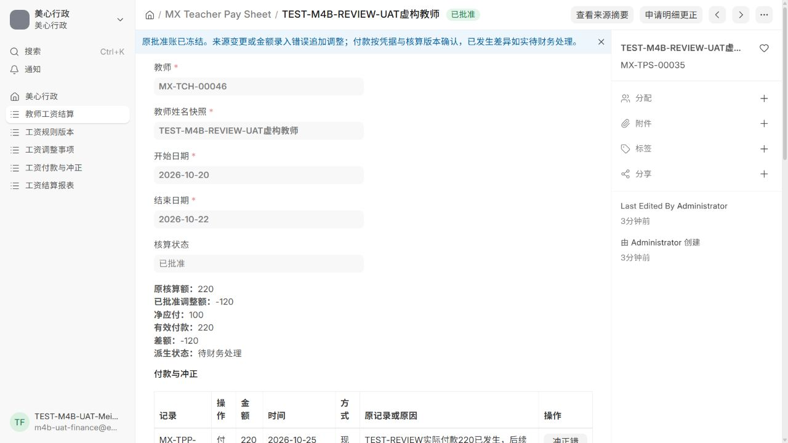

# M4-B Work复核修复与交付（2026-10-25）

隔离修复及本轮验证已完成。功能提交 `39fedab`；最终交付提交和草稿PR写入ZIP顶层版本清单。本轮用户授权修复、隔离验证及草稿PR，不授权合并、正式迁移或部署。

## 基线与实际复现

Work已实际审阅交付提交 `d351bdc8d25774a4a03e8172eaba306874b35d7d`。本轮沿用原独立分支 `m4-b-teacher-payroll`，开始时工作区干净；远端main实查仍为 `6fae2b9c978b3c812a0d999d01bec2dade9c3f80`。近期Frappe/ERPNext/HRMS复用调查继续适用，本轮只修现有服务与Desk能力，未新增依赖、安装HRMS或升级框架。

先在 `meixin_m4b_upgrade_check` / `test_meixin_m4.localhost` 的MariaDB中复现，再修改业务代码。所有教师、学生、付款均为虚构数据，没有银行转账。

- 原窗口核算220、虚构线下实际付款220；另一独立事务批准-120后，旧白名单接口成功保存付款金额和现金效果100，证实付款事实漂移。
- 对跨日期220元结算单只筛一日时，明细显示100而净应付仍显示220，原标签只有“单据首行”，未说明完整期间。
- 调整创建仅由授课事件进入，无一般财务纠错申请入口。
- 基线复现使用真实Frappe白名单接口调度、MariaDB及独立commit边界；不是网络HTTP或真实付款。清理仅本次TEST批次并恢复设置后，原虚构历史、余额、权限和角色摘要一致。

## 三项修复

付款普通入口要求财务明确输入实际付款额，提交打开窗口时的核算版本。两项均进入幂等内容；在原全站事务锁内使用原生 `for_update` 读取当前文档、重算版本及净额。缺少确认、金额不等额或版本改变时拒绝，不能用新净额替换实际金额。同一金额先减少再恢复，版本仍不同。

另设“已发生付款差异登记”，仅财务核对当前版本并填写原因、依据后记录真实正数现金事实。220实际已付而净应付100时，保存付款220和差额-120，状态待财务处理。净应付零/负或尚有待调整事项时，也可保留已发生的真实付款；这不代替正常付款批准，不自动扣款/退款。普通与差异登记共享单活动付款及冲正周期唯一约束，不能追加常规分次付款。

一般更正复用原调整类型。行政或财务可申请，目标必须是已批准原明细或同单已批准调整，二选一；保存追加差额、原目标快照、原因、依据、申请人和请求内容。仅财务批准，原账、原付款及课次占用不变。批准前比对目标及全单已批准调整集合，防止基于同一旧金额的不同请求重复批准。目标变化后可由财务明确驳回旧申请，再重新核对申请；驳回记录保留并与批准零元区分，真实来源撤销事项不能被驳回绕过。

更正已批准调整使用原调整ID及原快照摘要追踪，避免连续更正时重复嵌套JSON。五人误核四人的+20、独立工作固定费用误填和已批准调整填错均走此入口，不要求撤销正确授课。已付款后新增差额继续待财务实际处理。

报表页面提示、金额列名和导出同时明确“整单”含义，每行给出完整结算期间。日期只筛工资明细，整单净额、实际付款与差额在首个所选明细行展示，不按课程或日期分摊实际付款。

详细接口与结构见 [M4-B设计](M4_B_DESIGN.md)，增量字段和未来发布注意事项见 [迁移设计](M4_B_MIGRATION.md)。

## 本轮实际验证

| 实际运行 | 结果 | 证据 |
| --- | --- | --- |
| 原M1—M4-A 152 + 原工资54 + 本轮25完整回归 | **231/231**，0失败/错误/跳过，139.416秒；独立空测试库，三个原版本应用 | [完整日志](validation/m4-b-review-2026-10-25/clean-site-full-regression.log.gz)、[前后摘要](validation/m4-b-review-2026-10-25/clean-site-full-regression.json) |
| 保留虚构M4-A历史的本轮最终专项 | **25/25**，0失败/错误/跳过，25.264秒；旧事实、设置、余额、权限和角色前后摘要一致 | [专项日志](validation/m4-b-review-2026-10-25/review-tests-25-final.log.gz)、[历史对比](validation/m4-b-review-2026-10-25/review-tests-25-final.json) |
| 精确金额单测 | **2/2** | [金额日志](validation/m4-b-review-2026-10-25/money-unit-tests.log.gz) |
| 语法检查 | 85 Python、36 JSON（含旧证据）、16 JS通过；归档另校验JSON与SHA256 | [静态结果](validation/m4-b-review-2026-10-25/static-checks.json) |

231已包含25专项，不能相加为256；本表是2026-10-25实际新运行，没有复用旧201/54日志充当本轮通过。新增三个多进程竞争覆盖更正双批准、调整先取锁后的旧付款拒绝、付款先取锁后更正保留现金；16层连续更正链也实际通过。[原断言保留检查](validation/m4-b-review-2026-10-25/retained-regression-assertions.json)。

本轮旧M1—M4-A四个测试文件未改；旧54项工资测试仅适配明确实际金额及版本的必要输入，215条assert调用与方法分布保留。新增测试不是业务函数mock：通过真实Frappe白名单/HTTP方法调度器连接MariaDB，覆盖提交、回滚和独立连接多进程竞争；它们不等于网络HTTP端到端测试。网络HTTP及普通财务页面另行记录。

首轮新专项22项中，21通过、1项因测试进程JSON不能序列化Decimal失败；修正测试参数后24/24通过。后续加入连续更正链用例后重新运行，最终结果列在上表，旧日志保留。

首轮全套在保留历史的升级站运行230项，227通过、3项旧断言未通过：旧M1时区要求重庆、旧M3全表零扣减计数与原历史2笔扣减冲突、旧M3系统时区未配置。未删除旧历史或改弱断言；在同一隔离项目的独立空库和新测试站中配置约定时区后重跑原断言。保留历史升级站用于迁移和专项核验，空站用于完整回归，二者不能混称。

## 普通财务页面与HTTP

使用普通 `Meixin Finance` 虚构账号 `m4b-uat-finance@example.invalid`，在独立站18085完成：

- `MX-TPS-00035` 原窗口确认220；另一页申请/批准 `MX-TPA-00006` 减120。旧窗口真实POST携带220及旧版本，收到**HTTP417**，仍保留220和原参考号；付款未落为100。[HTTP记录](validation/m4-b-review-2026-10-25/browser/final-stale-http.json)
- 新差异窗口保存 `MX-TPP-00012`：实际付款220、当前净应付100、差额-120，待财务处理。
- `MX-TPS-00033` 五人误核四人，申请/批准 `MX-TPA-00007` +20，原100保留、净应付120。
- 独立工作单 `MX-TPS-00034` 原300，批准 `MX-TPA-00008` -30，再通过“申请更正本调整”关联申请/批准 `MX-TPA-00009` +10，净应付280；原300和-30事实保留。
- 使用Frappe原生查询参数筛选10月20日；跨期单只出现当日100元明细，完整期间仍为10月20日至22日，整单付款220不分摊。实际下载的CSV包含同样的范围、付款220和-120差额。[CSV](validation/m4-b-review-2026-10-25/browser/finance-single-day-report.csv)

[页面汇总](validation/m4-b-review-2026-10-25/browser/root-browser-check.json)。根代理新页面控制台warn/error为0；旧窗口的预期HTTP417及早期失败证据单独保留，不称全过程零错误。自动化直接填日期未生效的诊断截图20/21仍留本机，最终验证使用有明确日期值的原生报表链接和实际导出，不声称原生日历交互已通过。

浏览器首次暴露的原生Float输入在失败后丢失问题已记录，不能将首次截图当作最终通过。所有页面与凭据仅属测试站，旧UAT及本轮新虚构数据保留。

## 代码复核、迁移及范围

已按正确性、可读性、结构、权限安全和性能进行独立代码复核，未发现阻断本轮三项修复的问题；其后根代理汇总最终测试和浏览器证据。[独立复核及根代理补充](validation/m4-b-review-2026-10-25/independent-review.md)。新字段只增量添加；实际原生文档当前读、请求内容比较和单活动付款约束均受专项覆盖。

两个既有隔离站均先执行带附件备份，再进行增量schema迁移。新字段非旧单据必填，不改写已批准旧金额或付款事实；未新增DocType。正式六应用的镜像和revision仍为原M4-A。Docker引擎启动后既有服务按原策略恢复，本轮没有发出正式站点/数据库操作、正式配置变更、迁移或部署命令。

正式历史副本升级、正式镜像及public资产构建、长期运行和真实线下支付均未验证。继续M4-A单教师来源边界，不支持代课/共教。草稿PR不等于合并或部署批准；Work对本次新包的后续审查仍待进行，不能称为已通过其再次审核。

最终功能提交、交付提交、草稿PR及整包SHA256写入本轮ZIP顶层版本清单；包内包含完整已提交源码、增量/全量补丁及实际证据，排除私有密码、站点配置和数据库备份。

证据逐文件摘要和压缩日志无损解压校验见 [本轮证据索引](validation/m4-b-review-2026-10-25/index.json)。
